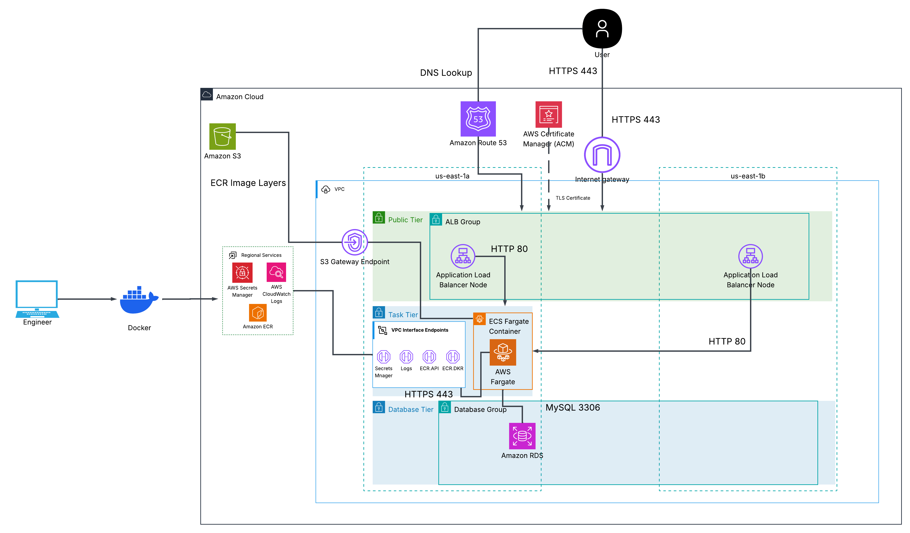

# Security Detection and Response on AWS
Containerized WordPress on AWS Fargate with automated threat detection and response (GuardDuty, EventBridge, Lambda).

## Before the Project
Practiced with Docker, created Docker Compose file for the Wordpress image and MYSQL database image to be hosted onto a container (will change to RDS later). Ran test opening http://localhost:8080 and confirmed container website accessbility. Used various docker commands in Powershell to assist the process. THIS PROCESS IS TO FAMILIARIZE MYSELF MORE WITH CONTAINERIZATION AND TO FIRST RUN THE CONTAINERS LOCALLY BEFORE SHIFTING TO BUILDING IN A PRODUCTION ENVIRONMENT.

## Overview
This project is built of a modified version of my HA scalable project, from a EC2-based WordPress setup to a immutable, scanned container image running on ECS Fargate in a private network. The point is not WordPress itself. WordPress is the workload being defended, and the focus is what happens around it: scanning the image before it runs, limiting what the task can reach, detecting suspicious activity, and responding automatically. Using the knowledge I learned learning Python and Docker to understand automated and containerized environments. 

## Architecture

Several design decisions were made such as:
| Decision | Choice | Why |
| :--- | :--- | :--- |
| **Image source** | Mirror a pinned official WordPress image into ECR | A task in a private subnet cannot reach Docker Hub, and ECR gives a scan point and a frozen copy. |
| **Task network** | Private subnet, no NAT, VPC endpoints | No outbound internet path limits what a compromised task can do. |
| **Telemetry & endpoints** | GuardDuty ECS Runtime Monitoring via VPC endpoints | Allows the GuardDuty security agent to send runtime telemetry from an isolated private subnet without internet access. |
| **TLS** | HTTPS with a domain and an ACM certificate, terminated at the ALB; port 80 redirects to 443 | The task receives plain HTTP on port 80 inside the VPC. This is what is deployed. |
| **Database** | RDS MySQL, single-AZ, private subnets | Managed, durable, and separate from the container lifecycle. |
| **Compute** | ECS Fargate, `awsvpc` networking, target group type `ip` | No hosts to patch, one network interface and security group per task, and the service replaces failed tasks. |
| **Task count** | 3 desired tasks, all in the single task-subnet AZ | Stopping one compromised task leaves the others serving while the service replaces it. |
| **Health check** | Target group accepts HTTP 200–399 | WordPress answers with a redirect (`302`), so a 200-only check marked healthy tasks as failed. |

# STILL WORKING ON IT

 

