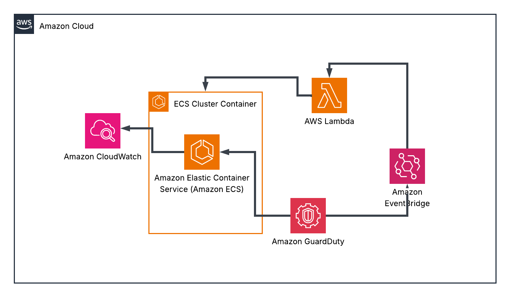
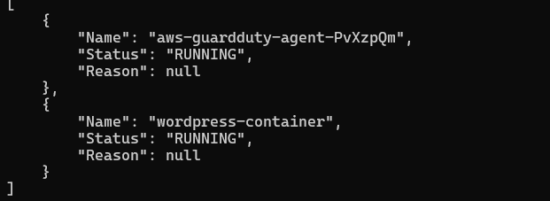
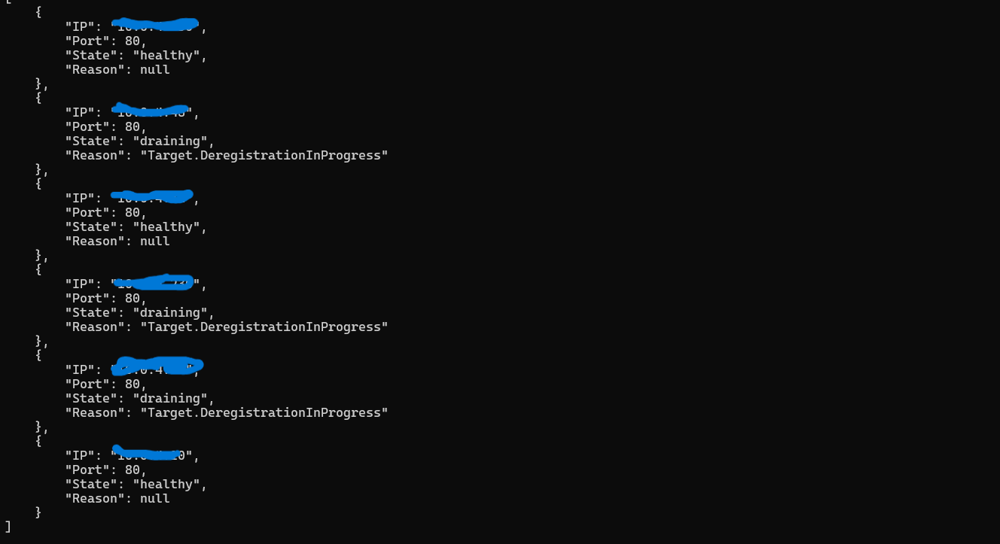
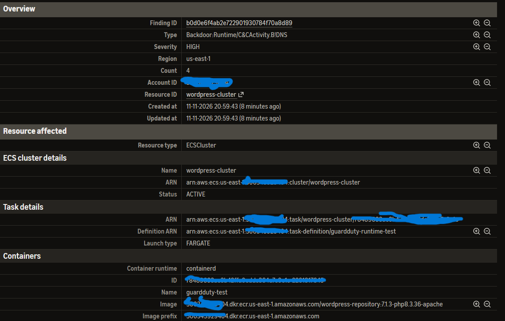
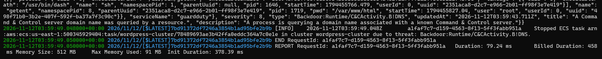
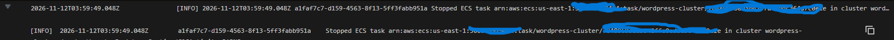

# Security Detection and Response on AWS
Containerized WordPress on AWS Fargate with automated threat detection and response (GuardDuty, EventBridge, Lambda).

## Before the Project
Practiced with Docker, created Docker Compose file for the Wordpress image and MYSQL database image to be hosted onto a container (will change to RDS later). Ran test opening http://localhost:8080 and confirmed container website accessbility. Used various docker commands in Powershell to assist the process. THIS PROCESS IS TO FAMILIARIZE MYSELF MORE WITH CONTAINERIZATION AND TO FIRST RUN THE CONTAINERS LOCALLY BEFORE SHIFTING TO BUILDING IN A PRODUCTION ENVIRONMENT.

## Overview
This project is built of a modified version of my HA scalable project, from a EC2-based WordPress setup to a immutable, scanned container image running on ECS Fargate in a private network. The point is not WordPress itself. WordPress is the workload being defended, and the focus is what happens around it: scanning the image before it runs, limiting what the task can reach, detecting suspicious activity, and responding automatically. Using the knowledge I learned learning Python and Docker to understand automated and containerized environments. 

## Architecture

## Design Decisions
| Decision | Choice | Why |
| :--- | :--- | :--- |
| **Image source** | Mirror a pinned official WordPress image into ECR | A task in a private subnet cannot reach Docker Hub, and ECR gives a scan point and a frozen copy. |
| **Task network** | Private subnet, no NAT, VPC endpoints | No outbound internet path limits what a compromised task can do. |
| **Telemetry & endpoints** | GuardDuty ECS Runtime Monitoring via VPC endpoints | Allows the GuardDuty security agent to send runtime telemetry from an isolated private subnet without internet access. |
| **TLS** | HTTPS with a domain and an ACM certificate, terminated at the ALB; port 80 redirects to 443 | The task receives plain HTTP on port 80 inside the VPC. This is what is deployed. |
| **Database** | RDS MySQL, single-AZ, private subnets | Cost optimization, kept project focused on detection and remediation rather than extreme high availability. |
| **Compute** | ECS Fargate, `awsvpc` networking, target group type `ip` | No hosts to patch, only one singular network interface and security group per task, and the service replaces failed tasks. No hardcoding addresses. |
| **Task count** | 3 desired tasks, all in the single task-subnet AZ | Stopping one compromised task leaves the others serving while the service replaces it. |
| **Health check** | Target group accepts HTTP 200–399 | WordPress answers with a redirect (`302`), so a 200-only check marked healthy tasks as failed. |
| **Scanning** | ECR basic scanning on push | All I needed for a short-lived environment. |
| **Detection** | GuardDuty with ECS Fargate runtime monitoring and RDS login events | Runtime monitoring sees behavior inside the container, such as DNS lookups of known command-and-control domains. The RDS data-risk feature was left off because its learning period does not fit a quick build-and-destroy workflow. |
| **Response** | Lambda stops the affected task when severity is 5.0 or higher | Response by replacement: the image is immutable and the task holds no state, so a fresh task from the trusted image replaces it instantly. Tested remediation to 5.3 seconds total. |

## Network and access control

### Subnets (`us-east-1`)

| Tier | Subnets | AZs | Route to internet |
| :--- | :--- | :--- | :--- |
| **Public** | 2 | `1a`, `1b` | Yes (ALB only) |
| **Task** | 1 | `1a` | No |
| **Database** | 2 (subnet group requirement) | `1a`, `1b` | No |

ALBs require two subents. RDS requires the subnet group to be attached to two subnets as well, but the instance itself runs in one AZ. The task subnet, endpoints, and database instance share an AZ to avoid cross-AZ traffic.

### Security group chain

Each group allows only what its own resource receives, and every source except the ALB's is another security group.

| Group | Attached to | Inbound |
| :--- | :--- | :--- |
| `alb-sg` | ALB | `80` and `443` from the internet |
| `task-sg` | Fargate tasks | `80` from `alb-sg` |
| `rds-sg` | Database | `3306` from `task-sg` |
| `endpoint-sg` | Interface endpoints | `443` from `task-sg` |

### VPC endpoints

Each endpoint is there because something specific calls it. If I cannot name the call, the endpoint is not created.

| Endpoint | Type | What needs it |
| :--- | :--- | :--- |
| `ecr.api` | Interface | The platform authenticates to ECR |
| `ecr.dkr` | Interface | The platform requests the image manifest |
| `s3` | Gateway | ECR stores image layers in S3 |
| `logs` | Interface | The container's logs go to CloudWatch |
| `secretsmanager` | Interface | Database credentials are injected at task startup |
| `guardduty-data` *(VPC endpoint)* | Interface | GuardDuty ECS Runtime Monitoring agent sends telemetry to GuardDuty |

**Left out on purpose:** `ecs`, `ecs-agent`, and `ecs-telemetry` (the Fargate platform handles that side, only required in ECS EC2) and `monitoring` (nothing inside the task publishes metrics).

**Troubleshooting Verification Process** The tasks start in the private subnet, which has no NAT and no public IP, so the image pulls (including the GuardDuty agent's image) and secret injection went through these endpoints. When the agent's image pull failed with a `403`, I checked the endpoint availability, private DNS, the S3 route table association, and the endpoint policies before concluding it was an IAM problem, not a network one. Gave ECS IAM role permissions to pull GuardDuty Agent image.

## IAM roles

| Role | Used by | What it can do |
| :--- | :--- | :--- |
| **Task execution role** | The ECS platform, on my behalf | Pull from my repository and from the GuardDuty agent's AWS-managed repository, write to this one log group, read this one secret *(and decrypt it with the customer-managed KMS key)* |
| **Task role** | The application code in the container | Nothing to really configure honestly. WordPress makes no AWS calls |
| **Lambda execution role** | The response function | Stop tasks (scoped to tasks in this cluster for least privellege) and write its own logs |

Both ECS roles trust `ecs-tasks.amazonaws.com`. The execution role's credentials are used by the platform and are not exposed to the container. The task role is available to the container, so it is deliberately empty: a compromised WordPress finds nothing to steal. The only statement that cannot be scoped to a resource is `ecr:GetAuthorizationToken`. `kms:Decrypt` is scoped to the specific KMS key encrypting the database secret.

## Image supply chain

### Current image

| Item | Value |
| :--- | :--- |
| **Upstream image** | `wordpress:7.1.3-php8.3-apache` *(rebuilt upstream with PHP 8.3.36)* |
| **Upstream digest (index)** | `sha256:d42f63cb89ad0eab272c4b393164e63830d0df270009907919f7dcce52b1a20b` |
| **ECR tag** | `7.1.3-php8.3.36-apache` *(my own tag)* |
| **ECR digest (single platform)** | `sha256:806680ba62232c4c300fb9dcc9f89d08e9e8c2bfc59837a1f58716f8648306d5` |
| **Mirrored** | `2026-10-22` |
| **ECR tag mutability** | `Immutable` |
| **Repository encryption** | `KMS (customer-managed key)` |
| **Platform** | `linux/amd64`, confirmed, matching the Fargate default |

**Why two digests.** The upstream tag points to a multi-platform index. My machine downloaded only the build for its own platform and pushed that single manifest, so the digest changed even though no layers were modified.

**Immutable decision.** I chose to make the image tag immutable due to the fact that it prevents container image tags from being overwritten, deleted, or altered once they are pushed to a registry. I also didn't want any malicious code or scripts from altering the code at runtime. It wipes out any persistent malware when the task is restarted which further supports the task shutdown and restart objective of this project.

## Case study: the PHP2Shell patch

### Timeline

| Date | Event | Details |
| :--- | :--- | :--- |
| **2026-10-21 (evening)** | Initial mirror | Mirrored `7.1.3-php8.3-apache` into ECR running **PHP 8.3.35**. |
| **2026-10-21** | Upstream advisory | PHP released fixes for two critical remote code execution flaws (`CVE-2026-109618` and `CVE-2026-109619`) in new releases including **8.3.36**. *(Sources: watchTowr FAQ and The Hacker News)* |
| **2026-10-22** | Patched re-pull & deploy | Re-pulled the same upstream tag and confirmed it pointed to a rebuilt image (**PHP 8.3.36**, built `2026-10-21`)—a live example of a mutable upstream tag. Because the old ECR tag is immutable, the patched image was pushed under a new tag (`7.1.3-php8.3.36-apache`) and the task definition was updated to match. |
| **Post-deploy** | Cleanup & retention | Verified the PHP version via the exact image name before pushing. Deleted the old `7.1.3-php8.3-apache` tag (`PHP 8.3.35`) from ECR so it cannot be deployed by accident. Its digest and scan counts are recorded here, though its findings can no longer be viewed. |

> **Takeaway:** The image had been frozen for less than a day before a critical flaw landed, illustrating the operational cost of an immutable mirror and the argument for continuous scanning *(see Future work)*.

### Scan results

ECR basic scan on push:

| Image | Scan date | Critical | High | Medium | Low | Info | Total |
| :--- | :--- | :---: | :---: | :---: | :---: | :---: | :--- |
| `7.1.3-php8.3-apache` *(PHP 8.3.35)* | `2026-10-21` | 13 | 106 | 71 | 16 | 0 | **206** *(table showed 704 rows)* |
| `7.1.3-php8.3.36-apache` *(PHP 8.3.36)* | `2026-10-22` | 2 | 17 | 66 | 14 | 0 | **99** *(table showed 99 rows)* |

## Web application firewall

A regional WAF web ACL is associated with the ALB. The default action is **allow**, because the site is public. Rules are evaluated in priority order:

| Priority | Rule | What it does |
| :---: | :--- | :--- |
| `1` | **AWS managed common rule set** | Blocks common web attacks such as SQL injection and cross-site scripting |
| `2` | **Login rate limit** | Blocks an IP that makes more than `20` requests to `/wp-login.php` within the rate-limit window |
| `3` | **General rate limit** | Blocks an IP that makes more than `2000` requests within the window |

* **Inbound IP blocking:** Rate-based rules count requests per IP over an evaluation window *(five minutes by default)* and block the IP automatically while it stays over the limit. That is the inbound IP-blocking layer. WAF is also configured to push logs to CloudWatch Logs for further analysis.
* **Separation of controls:** GuardDuty does not read from the WAF. Runtime findings describe what a task did *(such as a DNS lookup of a command-and-control domain)*, not a visitor's IP, so the two controls cover different directions: **WAF** handles inbound attacks, and GuardDuty handles runtime monitoring with the Lambda and handles a compromised workload.

## Detection and response
### How it works
1. Detection. 
GuardDuty ECS Fargate runtime monitoring runs an agent as a sidecar container in every task, so it sees behavior inside the running container (DNS lookups, processes, network connections). RDS login events are also monitored.
2. Routing. 
An EventBridge rule matches GuardDuty findings whose resource is an ECS cluster and passes them to a Lambda function. The function checks the severity.
3. Response. 
For severity 5.0 or higher, the Lambda extracts the affected task from the finding and calls ecs:StopTask with a reason that names the finding type. The ECS service sees the task count drop and starts a replacement from the trusted image. GuardDuty pushes alert to email through SNS aswell.
4. Response by replacement. 
Because the image is immutable and the task holds no state, replacing the task removes whatever the attacker planted. The other tasks keep serving traffic meanwhile.

## Test

I did not generate suspicious behavior against the WordPress service. Instead, I launched an isolated, disposable Fargate task with the GuardDuty agent running beside a test container, and used the domain AWS designates for GuardDuty command-and-control testing to produce DNS activity safely.

### Execution & Results

| Step | Result |
| :--- | :--- |
| **GuardDuty finding** | High severity `Backdoor:Runtime/C&CActivity.B!DNS` |
| **EventBridge** | Matched the ECS finding (severity `5` or higher) and invoked the Lambda |
| **Lambda** | Extracted the real affected task ARN from the finding and called `ecs:StopTask` |
| **ECS** | The task entered `STOPPED` with the reason `Automated remediation: Backdoor:Runtime/C&CActivity.B!DNS detected.` |
| **Timing** | About **5.3 seconds** from the finding's creation to the task's termination |

> **Timing note:** The timing starts when GuardDuty creates the finding. It does not include the time between the activity itself and the finding being created, so it measures the response and not the whole detection.

### Evidence

| Artifact | Path | What it shows |
| :--- | :--- | :--- |
| **Running task** |  | Both containers running in the task *(WordPress/test container + GuardDuty security agent)* |
| **Target group health** |  | Target group healthy | Draining targets are targets that are being deregistered for new ones
| **GuardDuty finding** |  | GuardDuty finding (`Backdoor:Runtime/C&CActivity.B!DNS`) |
| **Lambda log** |  | Lambda execution log extracting the `taskArn` and calling `ecs:StopTask` |
| **Stopped task** |  | Task stopped with the automated remediation reason | 

## Secrets and encryption

### Secret supply by environment

| Where | How secrets are supplied |
| :--- | :--- |
| **Local** | `.env` file *(git-ignored)*, read by Docker Compose |
| **AWS** | Secrets Manager, injected by the ECS execution role |

### ECS task definition configuration

In the task definition, non-secret settings and credentials share the exact same `WORDPRESS_DB_*` variable names used locally so the container image remains identical across both environments:

| Setting | Task definition block | Source |
| :--- | :--- | :--- |
| `WORDPRESS_DB_HOST` | `environment` | RDS endpoint address |
| `WORDPRESS_DB_NAME` | `environment` | RDS database name resource reference |
| `WORDPRESS_DB_USER` | `environment` | RDS database username resource reference |
| `WORDPRESS_DB_PASSWORD` | `secrets` | Secrets Manager secret ARN reference *(fetched and injected at startup)* |

### Encryption & hygiene

* **Value isolation:** The local and AWS credential sets are completely separate and never need to match.
* **Repository hygiene:** No credentials, Terraform state files, or `.tfvars` files are committed to version control.
* **KMS encryption:** Both the ECR repository and the Secrets Manager secret are encrypted with a **customer-managed KMS key**, trading off a small monthly key fee and a mandatory deletion waiting period when the environment is destroyed.

## Troubleshooting notes

Things that broke while building this, and why:

| Symptom | Cause | Fix |
| :--- | :--- | :--- |
| `docker login` to ECR returns `400 Bad Request` | PowerShell alters the piped token | Run the login through `cmd /c` |
| `InvalidClientTokenId` on a profile with an active key | Two IAM users with the same name in different accounts shared one profile name | Name profiles by account, and verify each with `aws sts get-caller-identity` |
| `Too many command line arguments` with `-target` | PowerShell splits the address at the dot | Quote the whole flag |
| Task can't start, can't assume role | Trust policy named `ecs.amazonaws.com` | Use `ecs-tasks.amazonaws.com` |
| Service creation fails: target group type `instance` is incompatible with `awsvpc` | Target group defaulted to instance targets | Set `target_type = "ip"` |
| Service places no tasks | Fargate-only task definition needs the service to launch on Fargate | Set `launch_type = "FARGATE"` |
| Log writes denied | The log group ARN doesn't cover the streams inside it | Append `:*` to the resource |
| GuardDuty agent container stays `STOPPED` with `CannotPullContainerError: 403 Forbidden` | The agent runs from an AWS-managed ECR repository, and the execution role could only pull from my own repository | Add that repository to the role's ECR pull permissions, scoped to it. *(The endpoints, private DNS, route table, and endpoint policies were all fine, so it was IAM and not routing.)* |
| New tasks fail health checks and are replaced in a loop | WordPress answers with a `302` redirect and the target group accepted only `200` | Set the matcher to `200-399` |
| Runtime monitoring enabled but existing tasks have no agent | The agent is added when a task is launched | Force a new deployment so the tasks are replaced |

## Future work
1. Outbound controls for a compromised task, such as Route 53 Resolver DNS Firewall or security group egress rules, since runtime findings describe what the task connected to
2. Preserve evidence before stopping a task, for example by capturing the full finding and task details to durable storage
3. Continuous scanning with Amazon Inspector, with findings routed into the same EventBridge pipeline, PHP2Shell patch made me realized how quickly immutable images can age and suddenly become highly vulnerable
4. Forward findings and logs to a SIEM such as Splunk 
5. CI/CD pipeline for build, scan, push, and deploy using a short-lived role, with a unique immutable tag per build
6. A hardened image phase: triage the scan, build an updated image, rescan, and compare
7. IAM Identity Center and AWS Organizations for multi-account access without long-term keys
8. A compliance mapping of the controls here to HIPAA and PCI-DSS control areas

## Security notes
Secrets, state files, and .tfvars are git-ignored. Account IDs are replaced with <account-id> in this document.
The task has no outbound internet path, and each security group allows only the tier above it.
A WAF in front of the ALB rate-limits abusive IPs and applies managed rules.

 

